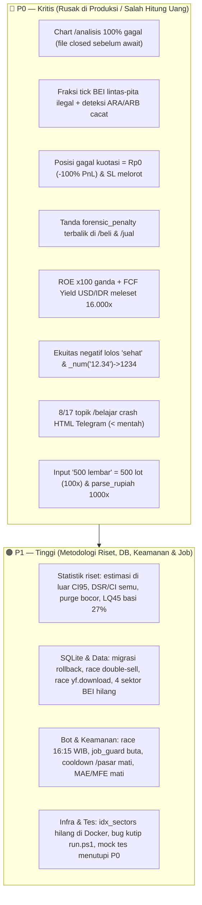

# Laporan Audit Menyeluruh — SahamBot (`SahamBuddy`)

**Tanggal Audit:** 24 November 2026  
**Cakupan:** Seluruh repositori (`bot.py`, `config.py`, 42 modul `core/`, 14 modul `handlers/`, 9 modul `research/`, `backtest*.py`, 5 skrip `tools/`, `Dockerfile`, `docker-compose.yml`, CI GitHub Actions, `data/*.json`, `.agents/skills/`, dokumentasi, dan suite pengujian `tests/`).

> [!CAUTION]
> Meskipun suite tes offline tampak hijau, audit baris-demi-baris menemukan **8 kelompok bug kritis (P0)** yang aktif merusak fitur utama di produksi atau menghasilkan salah hitung finansial/order ilegal BEI — termasuk **100% gagal kirim chart `/analisis`**, **harga SL/TP lintas-fraksi yang ditolak broker**, **posisi tanpa harga dihitung rugi -100% di `/portofolio`**, **rem `forensic_penalty` yang mati total karena salah tanda**, **inflasi ROE 100× & salah kurs FCF Yield ~16.000×**, serta **crash HTML Telegram pada 8 topik `/belajar`**. Sebagian besar bug P0 ini luput karena mock pada `tests/` menyamarkan perilaku objek asli.

---

## Ringkasan Eksekutif & Distribusi Temuan



| Domain | 🔴 Kritis (P0) | 🟠 Tinggi (P1) | 🟡 Sedang (P2) | 🟢 Rendah (P3) |
|---|---:|---:|---:|---:|
| Logika Finansial, Fundamental & Mikrostruktur BEI | 6 | 5 | 4 | 1 |
| Riset Kuantitatif, Statistik & Backtest | 0 | 7 | 4 | 1 |
| Database SQLite, Konkurensi, Cache & Ingesti Data | 0 | 5 | 7 | 2 |
| Handler Telegram, Keamanan, Job & UX | 2 | 6 | 5 | 1 |
| Docker, Skrip, Tooling, Pengujian & Dokumentasi | 0 | 4 | 4 | 2 |
| **Total Kelompok Temuan Terverifikasi** | **8** | **27** | **24** | **7** |

---

## Bagian A — Bug Kritis P0 (Wajib Diperbaiki Pertama)

### A1. Unggah Chart `/analisis` Selalu Gagal 100% di Produksi (`ValueError: I/O operation on closed file`)
- **Lokasi:** [analisis.py](file:///d:/coding/SahamBot/handlers/analisis.py#L351-L363), [bot.py](file:///d:/coding/SahamBot/bot.py#L169-L180)
- **Akar Masalah:** `_send_chart` ditulis sebagai fungsi sinkron `def`, sementara `msg.reply_photo(...)` di `python-telegram-bot` v21 adalah *coroutine function* (`async def`):
  ```python
  def _send_chart(_path=path, _sym=sym, _kb=kb):
      with open(_path, "rb") as f:
          return msg.reply_photo(photo=f, ...)  # hanya membuat objek coroutine, belum dieksekusi!
  ```
  Saat `_send_chart()` dipanggil oleh `send_with_retry`, blok `with open(...)` **langsung keluar dan menutup `f`** sebelum `await call()` dieksekusi. Ketika `httpx`/PTB membaca stream foto, Python melempar `ValueError: I/O operation on closed file`, yang kemudian ditelan diam-diam oleh `except Exception: log.exception("chart gagal utk %s", sym)`.
- **Mengapa Lolos Tes:** `_FakeMessage.reply_photo` di [test_bot_handlers.py](file:///d:/coding/SahamBot/tests/test_bot_handlers.py#L48-L50) tidak pernah memanggil `photo.read()` atau memeriksa `not photo.closed`.
- **Perbaikan:** Ubah `_send_chart` menjadi `async def` dan gunakan `return await msg.reply_photo(...)` di dalam blok `with open(...)`.

### A2. Order Harga Ilegal Lintas-Pita Tick BEI + Cacat Deteksi ARA/ARB & Absennya Papan Akselerasi
- **Lokasi:** [pricing.py](file:///d:/coding/SahamBot/core/pricing.py#L147-L229), [saran.py](file:///d:/coding/SahamBot/core/saran.py#L60-L70), [saran.py](file:///d:/coding/SahamBot/core/saran.py#L798-L804), [saran.py](file:///d:/coding/SahamBot/core/saran.py#L906-L922), [rencana.py](file:///d:/coding/SahamBot/core/rencana.py#L314-L327), [backtest_real.py](file:///d:/coding/SahamBot/backtest_real.py#L36-L55)
- **Rincian Cacat Mikrostruktur:**
  1. **Tick salah saat melintasi batas harga BEI (`Rp200 / Rp500 / Rp2.000 / Rp5.000`):** `stop_price`, `target_price`, `scale_out_plan`, dan `price_levels` menghitung `tick = pricing.tick_size(entry)` lalu memaksakan `tick` milik `entry` tersebut ke harga `SL`/`TP`. Contoh: `entry = 500` (`tick = 5`), `atr = 33` menghasilkan `SL = round_tick(467, 5) = Rp465` — **harga ilegal di BEI** (di bawah Rp500 wajib kelipatan Rp2, yaitu `Rp464`/`Rp466`, sehingga order otomatis ditolak Stockbit/JATS). Hal serupa terjadi saat `entry = 4.900` → `TP = 5.140` (wajib kelipatan Rp25 di `>= 5.000`).
  2. **`is_ara_locked` memakai `price` (bukan `prev_close`), meleset pada pembulatan tick, dan mati setelah 31 Des 2026:**
     - Tier persentase ARA BEI (`35%` / `25%` / `20%`) ditentukan oleh **Harga Acuan (`prev_close`)**, bukan `price` berjalan ([pricing.py](file:///d:/coding/SahamBot/core/pricing.py#L190)). Saham dengan `prev_close = 180` (ARA resmi `+35%` = Rp242) yang baru naik ke `Rp226` (`+25,6%`) dianggap masuk tier `>200` (`25%`) dan **salah ditandai terkunci ARA**.
     - Sebaliknya, saham `prev_close = 5.050` memiliki plafon ARA resmi BEI `floor_tick(6.060) = Rp6.050` (`+19,80%`), tetapi rumus `6050 >= 5050 * 1.20 * 0.999` (`6053,94`) bernilai `False` — **gagal mendeteksi kunci ARA asli**.
     - `auto_reject_pct` mengembalikan `None` di luar `2026-10-19..2026-12-31`, sehingga `ara_locked_series` di backtest 5 tahun mati pada 96% histori dan fitur ARA live akan **mati otomatis pada 1 Januari 2027**.
  3. **42 Saham Papan Akselerasi salah aturan ARB/ARA:** `data/idx_universe.json` memuat 42 emiten papan `Akselerasi` (batas ARA/ARB simetris **10%** & floor Rp1), tetapi `_is_special_board` ([pricing.py](file:///d:/coding/SahamBot/core/pricing.py#L196-L198)) hanya memeriksa `("pemantauan", "khusus", "fca")`.
  4. **Duplikasi `saran.arb_gap_risk` salah menandai saham stagnan Rp11–14 terkunci ARB:** Pada `prev_close = 14, price = 14` (`0%`), `ceil_tick(14 * 0.93) = 14.0`, sehingga `14 <= 14 * 1.001` memicu `arb_locked = True` palsu. Selain itu `round_tick`/`ceil_tick` crash (`ValueError`) jika menerima `NaN`.

### A3. Posisi Gagal-Kuotasi Dihitung Rugi -100% (Rp0) & Fallback SL/TP Ikut Melorot di `/portofolio`
- **Lokasi:** [portofolio.py](file:///d:/coding/SahamBot/core/portofolio.py#L115-L151), [portofolio.py](file:///d:/coding/SahamBot/core/portofolio.py#L224-L231)
- **Akar Masalah:**
  1. **Distorsi PnL total:** `cost_sum += cost` dijalankan tanpa syarat di baris 115, sedangkan `value_sum += value` hanya dijumlahkan bila `close > 0` di baris 128. Jika kuotasi Yahoo untuk 1 dari 2 saham gagal sementara (`close=None`), `pnl = value_sum - cost_sum` mengurangi seluruh modal saham tersebut seolah-olah nilainya menjadi **Rp0 (bangkrut -100%)** — melanggar Prinsip #1 `AGENTS.md` (*"tidak diisi nol"*).
  2. **Fallback SL/TP bergeser mengikuti harga turun:** Saat eksekusi belum menyimpan `sl`/`tp`, baris 134 & 150 menghitung `saran.stop_price(c_val, atr)` dari **harga pasar saat ini (`c_val`)**, bukan `avg_price` beli! Jika saham beli di Rp10.000 anjlok ke Rp7.000, SL di laporan ikut turun ke bawah Rp7.000 sehingga tidak pernah tampak jebol, padahal pelacak tesis di baris bawahnya memakai `avg_price` dan meneriakkan `🔴 Tesis: GUGUR`.
  3. **Risiko Rp0 saat harga jebol di bawah SL:** `row["risk"] = round(max(c_val - sl, 0.0) * shares)` (baris 143) menghasilkan **risiko Rp0** justru ketika saham sudah terkunci ARB jauh di bawah level SL!
  4. **Inkonsistensi rumus ATR:** `portofolio.atr14` memakai SMA 14 sederhana (`rolling(14).mean()`), berbeda dari RMA Wilder (`ewm(alpha=1/14)`) di `analysis.py`.

### A4. Pembalikan Tanda `forensic_penalty` Mematikan Rem Risiko & Mencetak Penalti Positif di `/beli` & `/jual`
- **Lokasi:** [verdict.py](file:///d:/coding/SahamBot/core/verdict.py#L109-L115), [verdict.py](file:///d:/coding/SahamBot/core/verdict.py#L146-L149), [verdict.py](file:///d:/coding/SahamBot/core/verdict.py#L284-L289) vs [fundamental.py](file:///d:/coding/SahamBot/core/fundamental.py#L362)
- **Akar Masalah:** `analyze_cashflow_quality` menghasilkan `forensic_penalty` sebagai angka **positif `0..90`**. Namun `verdict.py` mengasumsikan nilainya negatif:
  - Baris 146: `if ts_pct >= 50 and forensic_penalty > -15:` **selalu bernilai `True`** bahkan saat penalti forensik maksimum `90` poin! Emiten dengan arus kas operasi negatif parah tetap diberi rekomendasi `"🟢 TAHAN"`.
  - Baris 112 & 287: `{forensic_penalty:+.0f} poin` mencetak **`+40 poin`** untuk penalti pengurang skor 40 poin.
  - Selain itu, `verdict.py:213` membaca `res.get("as_of")` padahal `"as_of"` berada di `res["snap"]["as_of"]`, dan `handlers/trading.py:648` (`do_tanya`) lupa meneruskan `market_regime` ke `build_verdict`.

### A5. Inflasi ROE `100×` & Kesalahan Mata Uang `USD` vs `IDR` (`~16.000×`) pada `FCF Yield`
- **Lokasi:** [rencana.py](file:///d:/coding/SahamBot/core/rencana.py#L168), [banding.py](file:///d:/coding/SahamBot/core/banding.py#L156), [info.py](file:///d:/coding/SahamBot/handlers/info.py#L307), [fundamental.py](file:///d:/coding/SahamBot/core/fundamental.py#L165-L175), [fundamental.py](file:///d:/coding/SahamBot/core/fundamental.py#L398-L405)
- **Akar Masalah:**
  1. **ROE dikali 100 dua kali:** `fundamental._fetch_uncached` sudah mengalikan `returnOnEquity * 100.0` dan menandai `roe_unit="pct"`. Namun `rencana.py:168`, `banding.py:156`, dan `handlers/info.py:307` memanggil `normalize_roe(val)` **tanpa `unit=fund.get("roe_unit")`**. Akibat heuristik `abs(f) < 3.0`, setiap saham dengan ROE tipis antara `-3%` s.d. `+3%` (mis. `1,5%`) dikali 100 lagi menjadi **`150,0%`** — meloloskan saham berprofitabilitas nyaris nol dari peringatan `"ROE tipis"` dan menjadikannya tampak super-profitabel di `/rencana`, `/paket`, dan `/banding`!
  2. **Beda mata uang `FCF Yield` & `Market Cap` emiten berlaporan USD:** Untuk emiten komoditas/energi BEI berlaporan keuangan `USD` (`ADRO`, `ITMG`, `BYAN`, `INCO`, `MEDC`, `PGAS`, `MDKA`, `BRPT`, `BUMI`, `HRUM`), Yahoo mengirim `fcf` dalam `USD` (`financialCurrency`), sedangkan `market_cap` dan `eps` dalam `IDR` (`currency`). `compute_fcf_yield` membagi `fcf (USD) / market_cap (IDR) * 100`, mengecilkan FCF Yield sekitar **`16.000×`** menjadi `0,0%`! Sebaliknya, penggantian field `"currency"` dengan `financialCurrency` menyebabkan `market_cap` IDR berpotensi dilabeli `USD`.
  3. **Heuristik rapuh `div_yield` & `payout_ratio`:** Di [fundamental.py](file:///d:/coding/SahamBot/core/fundamental.py#L90-L109), jika `trailingAnnualDividendYield` kosong dan Yahoo mengisi `dividendYield = 0.85` (sudah persen `0,85%`), `normalize_div_yield` mengalikannya jadi **`85,0%`**. Sebaliknya jika `payoutRatio` desimal melonjak ke `6.5` (`650%` laba akibat laba anjlok), `normalize_payout` (`f <= 5.0`) menganggapnya sudah persen (**`6,5%`**) sehingga jebakan dividen ekstrem lolos tanpa penalti!

### A6. Emiten Ekuitas Negatif Lolos Sebagai `"✅ sehat"` & Bug Parser Angka `_num("12.34") -> 1234.0`
- **Lokasi:** [kualitas.py](file:///d:/coding/SahamBot/core/kualitas.py#L38-L86), [cek.py](file:///d:/coding/SahamBot/core/cek.py#L56-L63), [cek.py](file:///d:/coding/SahamBot/core/cek.py#L349-L391), [cek.py](file:///d:/coding/SahamBot/core/cek.py#L525-L558)
- **Akar Masalah:**
  1. Di `kualitas.judge()`, saat emiten bangkrut/merugi memiliki ekuitas buku negatif (`{"per": None, "pbv": -2.0, "roe": None}` — Yahoo mengosongkan `trailingPE` & `returnOnEquity`), fungsi melewati semua cabang veto karena tidak memeriksa `pbv <= 0` maupun kewajiban keterbacaan minimal `per`/`roe`, lalu mengembalikan **`{"ok": True, "label": "sehat", "reason": "laba positif, ROE cukup, valuasi tidak ekstrem"}`** di `/sinyal beli bagus`! `_f(v)` juga meloloskan `NaN` karena tidak mengecek `math.isfinite`.
  2. Di `cek._num(v)` (baris 58): `float(str(v).replace(".", "").replace(",", "."))` menghapus titik desimal pada string float standar — sehingga `_num("12.34")` menghasilkan **`1234.0`** (meleset `100×`!).
  3. Di `cek.py`: `pbv <= 0`, `forensic_flags` berat (`OCF < 0`, `DER > 300%`), maupun status suspensi/volume nol **tidak pernah mengurangi `points` atau menambah `vetoes`**, sehingga saham bermasalah masih bisa memperoleh kesimpulan **`LAYAK`**.

### A7. Delapan dari 17 Topik `/belajar` Gagal Terkirim di Telegram (`BadRequest: Can't parse entities`)
- **Lokasi:** [learn.py](file:///d:/coding/SahamBot/core/learn.py#L90-L262), [info.py](file:///d:/coding/SahamBot/handlers/info.py#L501-L503), [menu.py](file:///d:/coding/SahamBot/handlers/menu.py#L1089)
- **Akar Masalah:** `learn()` membungkus judul dengan `<b>...</b>` dan isi topik memuat tag `<b>oversold</b>` dll. sehingga dikirim langsung dengan `parse_mode=ParseMode.HTML` tanpa `esc()`. Namun 8 topik (`rsi`, `stochrsi`, `per`, `pbv`, `roe`, `dividend`, `der`, `powerscore`) mengandung tanda `<` mentah yang tidak di-escape menjadi `&lt;` (contoh: `<30:`, `<20 = oversold pendek, >80` yang dibaca parser HTML Telegram sebagai tag pembuka `<20 ...>` ilegal!).

### A8. Kesalahan Parsing Input `100×` (`lembar` Dianggap `lot`) & `1.000×` pada `parse_rupiah`
- **Lokasi:** [jurnal.py](file:///d:/coding/SahamBot/core/jurnal.py#L80-L99), [textutil.py](file:///d:/coding/SahamBot/core/textutil.py#L133-L162)
- **Akar Masalah:**
  1. `parse_exec_input` menghapus kata `lbr` dan `lembar` lewat `re.sub(r"\b(lot|lbr|lembar|rp|di)\b", " ", ...)` lalu memperlakukan angkanya langsung sebagai **lot** tanpa membagi 100! Pengguna yang mengetik `"500 lembar @ 9050"` tercatat membeli **500 lot (50.000 lembar — kesalahan posisi & modal 100× lipat)**.
  2. `parse_rupiah("1,500jt")` atau `"1.250jt"`: setelah memotong akhiran `jt` (`mult = 1e6`), regex `r"[.,]\d{3}$"` menghapus koma/titik desimal karena dianggap pemisah ribuan, menghasilkan **`Rp1.500.000.000` (Rp1,5 miliar, meleset 1.000× dari Rp1,5 juta)**. Sebaliknya `"5,000.50"` (format Inggris) menghasilkan `5.0005` (meleset 1.000× ke bawah).

---

## Bagian B — Kekurangan Metodologi Riset Kuantitatif, Statistik & Backtest (P1)

> [!WARNING]
> Angka yang ditampilkan kepada pengguna di `/validasi` berasal dari [validation.json](file:///d:/coding/SahamBot/data/validation.json). Terdapat inkonsistensi ekonometrika nyata di dalam berkas yang di-commit tersebut yang perlu diluruskan agar klaim kejujuran statistik bot benar-benar tahan uji.

### B1. Estimasi Titik Berada di Luar Confidence Interval 95%-nya Sendiri di `data/validation.json`
- **Lokasi:** [validation.json](file:///d:/coding/SahamBot/data/validation.json#L102-L121), [evaluate.py](file:///d:/coding/SahamBot/research/evaluate.py#L184-L217)
- **Bukti di `data/validation.json`:**
  - Rating `SELL`: `excess_pct = -0.56`, tetapi `ci = [-0.971, -0.603]` (`-0.56` berada **di luar batas atas `-0.603`**!).
  - Rating `STRONG SELL`: `excess_pct = -0.008`, tetapi `ci = [-0.402, -0.077]` (`-0.008` berada **di luar batas atas `-0.077`**!).
- **Penyebab:** `excess_pct` menghitung rata-rata berbobot baris/observasi (`g["excess"].mean()`), sedangkan `ci` mem-bootstrap rata-rata berbobot-sama per tanggal (`g.groupby("date")["excess"].mean()`) — dua estimand berbeda saat jumlah sinyal `STRONG SELL` membengkak di hari pasar jatuh. Lebih parah lagi, `bootstrap_ci` melakukan resampling **IID** pada deret harian return 20 hari yang *overlapping* (`MA(19)`), mempersempit lebar CI secara semu sekitar $\sqrt{20} \approx 4,5\times$.

### B2. Ilusi `ci95_alpha_net` (`p_positive = 1.0`) & Underestimasi Varians Trial pada DSR
- **Lokasi:** [portfolio.py](file:///d:/coding/SahamBot/research/portfolio.py#L127-L213), [portfolio.py](file:///d:/coding/SahamBot/research/portfolio.py#L481-L488), [experiments.py](file:///d:/coding/SahamBot/research/experiments.py#L306-L318)
- **Akar Masalah:**
  1. `moving_block_bootstrap_ci(n, block=4)` me-resample **20 rata-rata fase offset (`0..19`)** yang melewati rentang tahun 2022–2026 yang **95% identik**, bukan me-resample lintas ~55 periode waktu 20-harian! Itu hanya mengukur sensitivitas hari *rebalance*, bukan ketidakpastian sampel deret waktu dari alpha masa depan — sehingga menghasilkan CI super sempit `[+0,243%, +0,522%]` dengan `p_positive = 1.0`.
  2. Di `experiments.py:308`, `deflated_sharpe(nets, n_trials=320)` dipanggil per konfigurasi dengan `nets` berisi hanya 20 fase berkorelasi ~90% milik **1 konfigurasi itu saja** (mengabaikan varians Sharpe antar-16 konfigurasi), mengecilkan ambang penalti `sr0` secara sistematis.

### B3. Lookahead Eksekusi `close[i]`, Kebocoran *Purge* Libur Lebaran/Natal, & Drift Turnover
- **Lokasi:** [evaluate.py](file:///d:/coding/SahamBot/research/evaluate.py#L71-L100), [evaluate.py](file:///d:/coding/SahamBot/research/evaluate.py#L326-L374), [portfolio.py](file:///d:/coding/SahamBot/research/portfolio.py#L249-L265), [backtest.py](file:///d:/coding/SahamBot/backtest.py#L37-L45), [backtest_real.py](file:///d:/coding/SahamBot/backtest_real.py#L118-L134)
- **Rincian:**
  1. **Zero-lag close execution:** Fitur hari `i` memakai `close[i]` dan `volume[i]` (baru diketahui pasca-penutupan 16:00 WIB), tetapi target `fwd[i] = close[i+horizon] / close[i] - 1` mengasumsikan beli tepat di `close[i]` (memanen *bid-ask bounce* semu pada saham ber-tick lebar), padahal `/saran` live baru mengeksekusi di `open[i+1]`.
  2. **Kebocoran *label purge* saat libur panjang BEI:** `purged_split` mengonversi horizon 20 hari bursa menjadi `ceil(20 * 7 / 5) + 2 = 30` hari kalender (`embargo_days = 0`). Saat libur Idul Fitri/Lebaran atau Natal + Cuti Bersama BEI, 20 hari bursa memakan **36–40 hari kalender** (Desember di XIDX sering hanya memiliki <=19 hari bursa), sehingga harga Januari tahun uji bocor ke label `train` akhir November!
  3. **Biaya rebalance mengabaikan *weight drift*:** `turnover_cost(prev, cur)` membandingkan bobot target baru dengan bobot awal periode lalu (`prev`), mengabaikan pergeseran bobot akibat naik-turunnya harga selama 20 hari.
  4. **Mismatch SL/TP pada gap di `backtest_real.py`:** `PowerStrategy.next()` menghitung `sl, tp, shares` dari `Close[i]` padahal order terisi di `Open[i+1]`, berbeda dari `saran.fill_pending` yang menghitung ulang level dari `Open[i+1]`.

### B4. Korupsi Evaluasi Live `/jejak` (`scorecard.py`) Saat Saham Bagi Dividen
- **Lokasi:** [scorecard.py](file:///d:/coding/SahamBot/core/scorecard.py#L72-L151), [scorecard.py](file:///d:/coding/SahamBot/core/scorecard.py#L209-L251)
- **Akar Masalah:** `scan_history` menyimpan angka `entry` dan `sl` **sebelum** ex-date dividen. Saat dievaluasi 20 hari kemudian, `yfinance` (`auto_adjust=True`) mengalikan mundur seluruh histori harga pra-ex-date (mis. dividen 6% menurunkan semua `low` historis sebesar 6% — di bawah ambang split 25%). Akibatnya, perbandingan `window["low"] <= row["sl"]` **memicu `SL` (`-1.0R`) palsu** pada posisi yang sebenarnya untung! Selain itu `scorecard.py` belum memotong fee BEI 0,40% dan memakai `nlags=20` berbasis indeks baris scan, bukan hari bursa.

### B5. Cacat pada Modul Riset Terbaru, Universe `LQ45` Basi 27%, & Pergeseran Distribusi Produksi
- **Lokasi:** [evaluate_sector.py](file:///d:/coding/SahamBot/research/evaluate_sector.py#L43-L90), [bias.py](file:///d:/coding/SahamBot/research/bias.py#L108-L111), [bias.py](file:///d:/coding/SahamBot/research/bias.py#L178-L199), [saran.py](file:///d:/coding/SahamBot/core/saran.py#L28-L34), [evaluate.py](file:///d:/coding/SahamBot/research/evaluate.py#L86)
- **Rincian:**
  1. **Evaluasi *in-sample* berlabel OOS di `evaluate_sector.py`:** Mengevaluasi `relatif.WEIGHTS` langsung pada seluruh dataset 2017–2026 (termasuk tahun latih 2017–2025 tempat bobot tersebut dilatih!), memakai `ddof=0`, tanpa `Z_CLIP=3.0`, dan `min_sector_n=3` (produksi memakai `ddof=1`, `Z_CLIP=3.0`, `MIN_UNIVERSE=8`).
  2. **Bug `bias.py` & tabrakan cache horizon:** `bias.py:108` mencari key `"excess_ret_pct"`/`"mean_pct"` padahal `walk_forward` menghasilkan `"excess_pct"` — sehingga `q5_q1_spread` **selalu `None`**! Nama file cache `dataset_{period}_{n}.pkl` di `bias.py` & `evaluate_sector.py` juga tidak menyertakan `horizon`.
  3. **`saran.LQ45` melenceng 27% (12 dari 45 kode sudah keluar dari LQ45):** Dibandingkan dengan data repo sendiri di `research/lq45_membership_2016-2026.json`, `saran.LQ45` masih memuat 12 eks-anggota (`HMSP` & `MNCN` keluar sejak Feb 2023; ditambah `BREN, BRIS, CTRA, DSSA, JSMR, MAPI, PGEO, SRTG, TBIG, TPIA`) dan kehilangan 12 anggota aktif (`ADMR, BBTN, DEWA, ELSA, ERAA, ESSA, GOTO, HRTA, INCO, INDY, PWON, WIFI`).
  4. **Tautologi `ic_score_net`:** `fwd_net = fwd - 0.004` mengurangi konstanta seragam sebelum korelasi rank Spearman — secara matematis `rank(x - c) == rank(x)`, sehingga `ic_score_net` selalu 100% identik dengan `ic_score` bruto.
  5. **Diskonek model riset vs produksi:** Bobot Ridge dilatih pada 45 saham likuid LQ45 dengan bobot terkuat bersifat *mean-reversion* (`close_sma50 = -0.01766`, `breakout = -0.01032`), tetapi `screener.py` men-z-score lintas ~944 saham (termasuk 61 FCA & saham tidur) lalu memfilter ketat `close > sma50 AND sma20 > sma50 AND macd_hist > 0` yang justru membuang sinyal *mean-reversion* model itu sendiri.

### B6. Cacat Chandelier Exit Hari-0, Lompatan Bar Paper Trading, & Distorsi Risiko Sub-Portofolio
- **Lokasi:** [saran.py](file:///d:/coding/SahamBot/core/saran.py#L424-L427), [saran.py](file:///d:/coding/SahamBot/core/saran.py#L700-L766), [risk.py](file:///d:/coding/SahamBot/core/risk.py#L356-L405), [analysis.py](file:///d:/coding/SahamBot/core/analysis.py#L347-L422)
- **Rincian:**
  1. **False exit Chandelier saat beli *pullback*:** `chandelier_trailing_stop` menghitung `High_max(22) - 3*ATR` memakai puncak 22 hari **sebelum tanggal beli (`since_date`)**. Jika pengguna membeli saham saat koreksi sehat `>3×ATR` dari pucuk bulan lalu, tepat di hari beli `trail["hit"]` langsung `True` (`TRAILING_EXIT`)!
  2. **`update_paper` melewatkan bar harian di antaranya:** `_ohlc(q)` hanya mengambil `q.iloc[-1]`. Jika `/saran` tidak dibuka setiap hari, jebolnya `SL` atau tercapainya `TP` di hari kemarin terlewat begitu saja, dan gap-down open di bawah SL tetap dieksekusi di harga SL.
  3. **VaR, Volatilitas & Drawdown menyusut palsu di `risk.py`:** Jika 90% portofolio berada di saham baru (`<20` bar) dan 10% di `BBCA`, `w` tidak direnormalisasi sehingga 90% portofolio diperlakukan seperti kas ber-volatilitas `0%`, mengecilkan angka VaR Rupiah portofolio hingga 10× lipat! Selain itu korelasi saham stagnan (`std=0`) menghasilkan literal **`nan`** di pesan Telegram, dan sektor `"tidak diketahui"` dijumlahkan bersama sehingga memblokir `/rencana` saat Yahoo `.info` gangguan.
  4. **Skor teknikal tidak menormalisasi pembagi `MAX_SCORE = 90` & salah jam tutup BEI (`hour < 15`):** Saham `<50` bar mustahil mencapai `STRONG BUY` karena poin `sma50`/`sma200` dilewati tanpa mengecilkan pembagi `90`, sementara penalti volume intraday memakai jam `15:00` WIB (bursa tutup `16:00` WIB).

---

## Bagian C — Database SQLite, Konkurensi, Cache & Ingesti Data (P1–P2)

### C1. Kehilangan Data Migrasi Saat Rollback, *Race Condition* Jual-Ganda, & Hantu Posisi Terbuka
- **Lokasi:** [store.py](file:///d:/coding/SahamBot/core/store.py#L367-L452), [store_portfolio.py](file:///d:/coding/SahamBot/core/store_portfolio.py#L77-L88), [store_portfolio.py](file:///d:/coding/SahamBot/core/store_portfolio.py#L121-L149), [store_portfolio.py](file:///d:/coding/SahamBot/core/store_portfolio.py#L634), [store_scan.py](file:///d:/coding/SahamBot/core/store_scan.py#L197-L198)
- **Rincian:**
  1. **Rename `store.json` sebelum `COMMIT`:** Di `_ensure_ready` ([store.py](file:///d:/coding/SahamBot/core/store.py#L379-L387)), `_migrate_json` mengeksekusi `INSERT` tanpa `conn.commit()` lalu langsung me-rename `store.json -> store.json.migrated` sebelum masuk `with conn:`. Jika transaksi pemanggil gagal/rollback, seluruh data hasil migrasi hilang sementara file sumber sudah berubah nama.
  2. **Race jual-ganda (`_reduce_real_position_conn`):** `SELECT lots, avg_price` berjalan tanpa `BEGIN IMMEDIATE` dan `DELETE`/`UPDATE` tidak memverifikasi `cur.rowcount`. Dua request jual paralel untuk 5 lot yang sama sama-sama lolos pengecekan `n > held` dan mencatat **dua transaksi `JUAL`** di `real_trades` & `real_executions`.
  3. **Bug hantu posisi terbuka (`open_executions_by_ticker` baris 634):** `if open_pos and t not in open_pos: continue` — ketika pengguna menjual habis posisi terakhirnya (`open_pos == {}`, bernilai *falsy*!), filter ini mati dan mengembalikan siklus eksekusi lama yang belum seimbang seolah masih aktif!
  4. **Backup korup merotasi keluar backup sehat:** Jika `PRAGMA integrity_check` gagal di `store_scan.py:197`, `backup_to` melempar `RuntimeError` tanpa menghapus file backup rusak tersebut, sehingga rotasi berikutnya mempertahankan file rusak dan menghapus backup tua yang sehat.
  5. **Drift `SCHEMA_VERSION = 6` & lolosnya `NaN`/`inf`:** Tabel `daily_snapshots` ditambahkan tanpa menaikkan `SCHEMA_VERSION` ke `7`; `_check_lot_price` menggunakan `p <= 0` yang bernilai `False` untuk `NaN` dan `inf`.

### C2. *Race Condition* Global `yf.download` Lintas Thread, Kebocoran Memori Cache, & Tabrakan `.tmp`
- **Lokasi:** [data.py](file:///d:/coding/SahamBot/core/data.py#L168-L186), [data.py](file:///d:/coding/SahamBot/core/data.py#L229-L265), [data.py](file:///d:/coding/SahamBot/core/data.py#L609-L612), [bandar.py](file:///d:/coding/SahamBot/core/bandar.py#L27-L70)
- **Rincian:**
  1. **`yf.download` tidak *thread-safe*:** `yfinance.download` berbagi state global `yfinance.multi._SHARED._DFS`. Saat `/portofolio` (`Semaphore(4)`), `/banding`, atau beberapa pengguna memanggil `fetch_history` bersamaan lewat `asyncio.to_thread`, hasil OHLCV antar-emiten dapat saling menimpa atau menghasilkan DataFrame kosong palsu (seharusnya memakai `yf.Ticker(sym).history(...)` untuk single-ticker).
  2. **Kebocoran RAM & disk tak terbatas:** `data._mem`, `data._name_cache`, `bandar._cache`, `temp/cache/bandar/*.json`, dan tabel SQLite `plan_cache`/`daily_snapshots`/`div_reminders` tidak memiliki batas ukuran maksimum (LRU) maupun pembersihan entri kedaluwarsa.
  3. **Tabrakan penulisan `.tmp`:** `_save_cache` dan `_write_meta` menulis ke nama tetap `path + ".tmp"` tanpa akhiran thread/UUID, rawan `PermissionError: [WinError 32]` di Windows atau korupsi file saat *cache miss* paralel.

### C3. Empat dari 11 Sektor Resmi BEI Hilang Permanen + Deteksi Stale `bandar` Rusak Lintas Thread
- **Lokasi:** [sektor.py](file:///d:/coding/SahamBot/core/sektor.py#L22-L41), [sektor.py](file:///d:/coding/SahamBot/core/sektor.py#L114-L116), [bandar.py](file:///d:/coding/SahamBot/core/bandar.py#L29-L50)
- **Rincian:**
  1. Kode resmi indeks sektor BEI (IDX-IC) di JATS/`GetIndexSummary` menggunakan 9 karakter untuk 4 sektor utama: **`IDXINDUST`** (Perindustrian), **`IDXNONCYC`** (Konsumen Primer), **`IDXCYCLIC`** (Konsumen Non-Primer), dan **`IDXPROPERT`** (Properti). Keempat kode resmi ini **tidak ada** di `SECTOR_NAMES`, sehingga selalu dibuang diam-diam di `/sektor`, `/pasar`, dan laporan penutupan 16:15 WIB!
  2. `bandar._stale_local` memakai `threading.local()`. Saat handler memanggil `await asyncio.to_thread(bandar.get_index_summary)`, penanda umur basi disimpan di *worker thread*, bukan *event loop thread* — sehingga data cache BEI berumur 48 jam ditampilkan seolah-olah data *live* hari ini di `/sektor` dan `/pasar`.

### C4. Bias `0` Artikel Berita = `0.0%`, Positif Palsu `"ara"`, & Risiko `KeyError`/Unduhan Live di `news_ml`
- **Lokasi:** [news.py](file:///d:/coding/SahamBot/core/news.py#L200-L209), [news.py](file:///d:/coding/SahamBot/core/news.py#L598-L655), [news_ml.py](file:///d:/coding/SahamBot/core/news_ml.py#L126-L195)
- **Rincian:**
  1. Saat tidak ada berita (`[]`), `news_sentiment([])` mengembalikan `pct = 0.0` (bukan `None`), yang menyeret `PowerScore` sebesar bobot 20% mendekati nol dan justru memberi bonus `+1` poin kualitas di `rencana.py:278`.
  2. Kata `"ara": 2.0` di kamus positif mencocokkan nama panggilan tokoh publik (mis. *"Menteri Ara"* → skor bullish `+66,6%`), dan kata `"ekuitas"` di `_OTHER_METRICS` membatalkan aturan turunnya utang pada judul *"Rasio utang terhadap ekuitas turun"* (dinilai bearish `-1.0`).
  3. Di `news_ml.py`: sesi ONNX tidak memiliki atribut `.config` sehingga `_id_to_label` mengabaikan `config.json`; jika label model bukan `"positive"`/`"negative"`, `news.py:598` crash dengan `KeyError` di luar blok `try`; dan bila `LOCAL_MODEL_DIR` kosong saat `torch` terpasang, `get_model()` mengunduh langsung dari HuggingFace tanpa pin `revision`.

---

## Bagian D — Handler Telegram, Keamanan, Job Terjadwal & UX (P1–P2)

### D1. *Race Condition* Pasti Pukul 16:15 WIB & `@job_guard` Lumpuh pada Job Kritis
- **Lokasi:** [bot.py](file:///d:/coding/SahamBot/bot.py#L1440-L1446), [jobs.py](file:///d:/coding/SahamBot/handlers/jobs.py#L730-L755), [screener.py](file:///d:/coding/SahamBot/core/screener.py#L444-L447)
- **Rincian:**
  1. **`closing-market-report` mendahului `full-market-scan` setiap hari:** Keduanya dijadwalkan tepat pukul `16:15 WIB`. Laporan penutupan selesai dalam ~3 detik dan membaca `market_scan` **kemarin**, sementara pemindaian 944 saham baru selesai 3–6 menit kemudian (~16:20 WIB)! Selain itu, jika seseorang menjalankan `/scan` pukul 08:00 WIB pagi, `scanned_at[:10] == _today_wib()` mengunci cache sehingga job 16:15 WIB (`force=False`) **batal memperbarui harga penutupan sore hari itu**!
  2. **`@job_guard` dikelabui `try/except` internal:** `backup_job` menangkap semua `Exception` dan hanya menulis log tanpa melempar ulang — sehingga saat backup SQLite gagal (disk penuh/DB korup), `@job_guard("backup-store")` tidak pernah mengirim alert ke admin dan justru mencatat `fails = 0, last_ok = now` di `/status`! `full_market_scan_job` juga menandai `last_ok = now` meski scan gagal.

### D2. Celah Keamanan, Rate-Limiting/DoS & Isolasi State Grup
- **Lokasi:** [guards.py](file:///d:/coding/SahamBot/core/guards.py#L16-L20), [menu.py](file:///d:/coding/SahamBot/handlers/menu.py#L1228-L1253), [watchlist.py](file:///d:/coding/SahamBot/handlers/watchlist.py#L147-L253), [bot.py](file:///d:/coding/SahamBot/bot.py#L99-L100), [bot.py](file:///d:/coding/SahamBot/bot.py#L1428-L1429), [btcache.py](file:///d:/coding/SahamBot/core/btcache.py#L19-L27), [sinyal.py](file:///d:/coding/SahamBot/handlers/sinyal.py#L223-L236)
- **Rincian:**
  1. **Cooldown `/pasar` mati total + banyak endpoint berat tanpa pembatas laju:** `do_pasar` memanggil `cooldown_ok(update, "pasar")`, tetapi key `"pasar"` **tidak terdaftar** di `_COOLDOWN_SECONDS`! Ditambah lagi `/beli`, `/jual`, tanya teks bebas, `/berita` (inferensi RoBERTa), `/fundamental`, `/skor` (8 saham), `/watch list` (30 saham), dan `/agenda` sama sekali tidak memiliki `cooldown_ok`.
  2. **Crash pada post kanal/admin anonim & eksekusi ganda `edited_message`:** `MessageHandler` menerima semua `Update.ALL_TYPES` tanpa filter `UpdateType.MESSAGE` dan mengakses `update.effective_user.id` tanpa cek `None` (`AttributeError` saat `effective_user` kosong; edit pesan memicu ulang pencatatan jurnal/tanya).
  3. **Pembajakan/penghapusan `PENDING` di grup:** `PENDING` disimpan per `chat_id` (bukan `(chat_id, user_id)`). Di grup, pesan user tak berizin menghapus sesi `PENDING` milik admin, atau angka yang diketik anggota grup lain tercatat ke portofolio asli saat `exec_buy` aktif.
  4. **DoS `/alert` tanpa kuota & crash `>4096` karakter:** Tidak ada batas jumlah simbol maupun jumlah target harga di `/alert`, dan `/alert list` memakai `reply_text` biasa yang gagal permanen begitu melampaui 4.096 karakter.
  5. **`ADMIN_IDS` *fail-open*, jadwal tetap jalan bagi user yang dihapus dari allowlist, CSV Injection & Path Traversal:** Kesalahan format `ADMIN_IDS` (mis. spasi/handle) menghasilkan `set()` kosong yang membuka `/status` ke publik; job otomatis tidak menyaring `ALLOWED_IDS`; `_sinyal_csv` tidak menetralkan karakter formula Excel (`=`, `+`, `-`, `@`); dan fallback `_symbol_key` di `btcache.py` meloloskan `../` bila `normalize_ticker` gagal.

### D3. Fitur MAE/MFE Mati di Produksi, Tombol Merusak Pesan Asli, & Cacat Format HTML
- **Lokasi:** [jurnal.py](file:///d:/coding/SahamBot/handlers/jurnal.py#L390-L395), [jobs.py](file:///d:/coding/SahamBot/handlers/jobs.py#L804-L811), [menu.py](file:///d:/coding/SahamBot/handlers/menu.py#L1157-L1163), [cek.py](file:///d:/coding/SahamBot/handlers/cek.py#L159-L160), [verdict.py](file:///d:/coding/SahamBot/core/verdict.py#L402-L406), [market.py](file:///d:/coding/SahamBot/handlers/market.py#L551-L552), [textutil.py](file:///d:/coding/SahamBot/core/textutil.py#L66-L130), [reports.py](file:///d:/coding/SahamBot/core/reports.py#L57-L59), [reports.py](file:///d:/coding/SahamBot/core/reports.py#L269)
- **Rincian:**
  1. **MAE/MFE `/jurnal` 100% mati di produksi:** Baik `handlers/jurnal.py:392` maupun `weekly_journal_report` (`jobs.py:804`) **tidak pernah mengambil atau meneruskan `bars_by_ticker`** ke `jurnal_diagnostics()` (dan laporan mingguan juga lupa meneruskan `bench_close` untuk alpha vs IHSG).
  2. **Menekan tombol tindak lanjut menghapus isi laporan sebelumnya:** Mengetuk tombol `tick:*`, `refresh:*`, atau `run:pasar` memanggil `_safe_edit(msg, "⏳ Memproses BBCA...")` yang **menimpa dan menghapus permanen** laporan `/cek`, `/analisis`, atau alert jual tempat tombol itu berada, lalu mengirim hasil baru di pesan terpisah!
  3. **Perintah `/` tidak pernah membersihkan `PENDING` (TTL 1 jam):** Jika user mengetuk tombol input manual lalu beralih mengetik `/cek BBCA`, state `PENDING` tetap menggantung 1 jam dan membajak pesan teks bebas berikutnya.
  4. **HTML `<i>` ter-escape ganda & pemotongan `<blockquote expandable>` rusak:** `quality_note` sudah mengandung tag `<i>...</i>`, tetapi di-`esc()` ulang di `/cek`, `/beli`, `/jual`, dan `/rencana` sehingga tampil literal `⚠️ 🧪 <i>Kualitas data: ...</i>`. Sementara `split_message` hanya menyeimbangkan `<pre>`, sehingga laporan panjang yang terpotong di tengah `<blockquote expandable>` ditolak HTML parser Telegram.
  5. **Pembulatan menyesatkan di `reports.py`:** Laba kuartalan `< Rp500 juta` diformat `Rp0M` / `-Rp0M`, dan sentimen berita negatif `-0.85` diformat `('%+d' % -0.85)` menjadi **`(+0)`**!

---

## Bagian E — Infrastruktur Docker, Tooling, Pengujian & Dokumentasi (P1–P3)

### E1. `data/idx_sectors.json` Hilang dari Image Docker & Masalah Bind-Mount `./data:/app/data`
- **Lokasi:** [.dockerignore](file:///d:/coding/SahamBot/.dockerignore#L6-L8), [Dockerfile](file:///d:/coding/SahamBot/Dockerfile#L38-L40), [docker-compose.yml](file:///d:/coding/SahamBot/docker-compose.yml#L18)
- **Rincian:**
  1. `.dockerignore` mengecualikan `data/*` dan hanya mengecualikan balik `!data/validation.json` serta `!data/idx_universe.json` — **melupakan `!data/idx_sectors.json`**! `Dockerfile` juga tidak memiliki baris `COPY data/idx_sectors.json`. Akibatnya, seluruh container Docker yang berjalan mandiri tidak memiliki pemetaan sektor untuk 944 emiten!
  2. `docker-compose.yml` melakukan bind-mount `./data:/app/data` ke folder `data/` yang sama dengan file statis repo (`validation.json`, `idx_universe.json`, `idx_sectors.json`). Jika dipasang pada *named volume* atau folder kosong di VPS, file statis di dalam image akan tertimpa kosong; sebaliknya di repo lokal, folder `data/` tercampur dengan `store.db`, `temp/`, `cache/`, dan `backups/`. Sebaiknya pisahkan direktori runtime (`/app/var` atau `./runtime:/app/runtime`) dari aset statis `/app/data`.
  3. `Dockerfile` menyalin `vendor/` (`kronos`) ke image produksi padahal hanya dipakai oleh skrip riset `research/evaluate_kronos.py` (dan `vendor/kronos/kronos.py:9` memanggil `sys.path.append("../")` saat diimpor).

### E2. Bug Skrip Starter (`run.ps1`, `run.sh`), Tooling & `download_model.py`
- **Lokasi:** [run.ps1](file:///d:/coding/SahamBot/run.ps1#L14-L16), [run.sh](file:///d:/coding/SahamBot/run.sh#L26-L32), [config.py](file:///d:/coding/SahamBot/config.py#L81), [backup_db.py](file:///d:/coding/SahamBot/tools/backup_db.py#L18-L23), [build_sectors.py](file:///d:/coding/SahamBot/tools/build_sectors.py#L6-L78), [download_model.py](file:///d:/coding/SahamBot/download_model.py#L21-L89), [deploy.md](file:///d:/coding/SahamBot/deploy.md#L133)
- **Rincian:**
  1. **Autentikasi gagal di Windows (`run.ps1`):** `run.ps1` menyetel environment variable dari `.env` tanpa menghapus tanda kutip `"`/`'`. Karena `config.py` memakai `os.environ.setdefault`, nilai bertanda kutip dari `run.ps1` menang dan `clean_token()` tidak menghapus tanda kutip — sehingga `BOT_TOKEN="123:abc"` di `.env` menyebabkan `InvalidToken`!
  2. **Eksekusi shell `. ./.env` di `run.sh` & crash `int()` di `config.py`:** `run.sh` men-*source* `.env` sebagai skrip bash (rawan gagal/injeksi bila ada spasi atau karakter khusus, serta tidak menyaring placeholder `tempel*`). `config.py:81` langsung memanggil `int(os.getenv("BACKUP_KEEP", "7"))` tanpa `try/except ValueError`.
  3. **`tools/backup_db.py` mengabaikan `--keep`:** `check_sync.py:335` memanggil `backup_db.main([str(backup_dir), "--keep", "3"])`, tetapi `backup_db.py` tidak memakai `argparse` sehingga `--keep 3` diabaikan (dan bila dijalankan `python tools/backup_db.py --keep 3` dari CLI, ia membuat folder bernama `./--keep`!).
  4. **`tools/build_sectors.py` rusak di lingkungan bersih:** Mengimpor `bs4` (`beautifulsoup4`) dan `lxml` yang **tidak terdaftar** di `requirements*.txt`, mendokumentasikan flag `--yf-fallback` yang tidak pernah diimplementasikan, serta memalsukan `User-Agent` sebagai `Google-Agent` crawler resmi Google.
  5. **Celah integritas `download_model.py`:** Permintaan ukur ukuran file di baris 21 melakukan full `GET` (bukan `method="HEAD"`), menganggap file apa pun berukuran `> 0` byte sudah lengkap (baris 87), menerima file `have > total`, berpotensi *infinite loop* bila proxy mengembalikan HTTP 200 parsial berulang (`failures = 0` ter-reset tiap `wrote > 0`), dan tidak memverifikasi SHA-256 model ~500 MB.
  6. **Salah nama container di `deploy.md:133`:** Menulis `docker compose exec bot ...` padahal nama servis di `docker-compose.yml` adalah `saham-bot`.

### E3. *Blind Spots* Suite Pengujian (`tests/`) & Ketertinggalan Dokumentasi
- **Lokasi:** [conftest.py](file:///d:/coding/SahamBot/tests/conftest.py#L46-L79), [test_phase2_handlers_ux.py](file:///d:/coding/SahamBot/tests/test_phase2_handlers_ux.py#L241), [test_job_guard.py](file:///d:/coding/SahamBot/tests/test_job_guard.py#L50), [AGENTS.md](file:///d:/coding/SahamBot/AGENTS.md#L54-L102), [ci.yml](file:///d:/coding/SahamBot/.github/workflows/ci.yml#L30-L35)
- **Rincian:**
  1. **Mock yang menyembunyikan bug P0/P1:**
     - Mock `reply_photo` tidak memverifikasi handle file masih terbuka (menyembunyikan **A1**).
     - Tes `verdict` mem-mock `"forensic_penalty": -10.0` bertanda negatif yang berlawanan dengan output positif `fundamental.py` (menyembunyikan **A4**).
     - Tes `cek` mem-mock `"quality_note"` sebagai teks polos alih-alih output HTML `data_quality.summary_line()` (menyembunyikan **D3.4**).
     - `test_job_guard.py` hanya memeriksa atribut `__wrapped__` tanpa mensimulasikan `backup_to` gagal (menyembunyikan **D1.2**).
  2. **Isolasi fixture belum kedap:** `tmp_store` di `conftest.py` tidak `autouse=True` (tes yang lupa memintanya akan menulis ke `store.db` kerja) dan `_isolated_caches` tidak me-reset `bot.ALLOWED_IDS`, `bot.PENDING`, `bot._last_used`, `bot.JOB_STATUS`, maupun `handlers.trading._LAST_SARAN_META`.
  3. **Gerbang CI utama belum menjalankan `check_sync.py` & `evaluate_sentiment.py`:** `.github/workflows/ci.yml` hanya menjalankan `ruff` dan `pytest`, sementara `check_sync.py` sendiri belum memvalidasi keberadaan/kesegaran `data/idx_sectors.json` maupun sinkronisasi `saran.LQ45` terhadap `lq45_membership_2016-2026.json`.
  4. **Dokumentasi tertinggal pasca-commit `2057bcb`–`9dbf63a`:** `AGENTS.md`, `PLAN.md`, `README.md`, `CHANGELOG.md`, dan komentar `requirements.txt` belum diperbarui mengikuti perubahan arsitektur terbaru (mis. `AGENTS.md` masih menulis `bot.py` 1.865 baris / 35 modul `core/` / 13 modul `handlers/` / `research/bias.py` belum ada, padahal kini `bot.py` 1.463 baris, 42 berkas `core/`, 14 modul `handlers/`, dan `bias.py` + `evaluate_sector.py` + `build_sectors.py` sudah masuk). `core/types.py` juga memuat definisi `TypedDict` yang berbeda key dengan dict runtime sebenarnya.

---

## Roadmap Perbaikan yang Disarankan (Sesuai Konvensi Satu Domain per Commit)

> [!TIP]
> Sesuai aturan `AGENTS.md` Bagian 4, hindari *big-bang refactor*. Eksekusi perbaikan dalam 4 gelombang terukur berikut, dengan menambahkan tes regresi nyata (tanpa mock yang memalsukan kontrak modul) di setiap langkah.

1. **Gelombang 1 — Penyelamatan Fungsional & Akurasi Finansial (P0):**
   - Perbaiki `async def _send_chart` di `handlers/analisis.py` + perketat `_FakeMessage.reply_photo` di tes agar menolak file tertutup.
   - Perbaiki pembulatan tick per-level (`round_tick(px)` tanpa memaksa tick `entry`), rumus `is_ara_locked` berbasis `prev_close` + `floor_tick` + dukungan Papan Akselerasi & lintas tahun di `core/pricing.py`.
   - Perbaiki PnL posisi `unpriced`, SL/TP berbasis `avg_price`, risiko saat harga `< SL`, dan RMA Wilder di `core/portofolio.py`.
   - Perbaiki tanda `forensic_penalty` & `snap["as_of"]` di `core/verdict.py`, teruskan `unit=roe_unit` di `rencana.py`/`banding.py`/`info.py`, pisahkan `financial_currency` vs `price_currency` untuk `FCF Yield`, ketatkan `kualitas.judge()` & `cek._num()`, escape `<` di `core/learn.py`, dan perbaiki parser `lembar` (`jurnal.py`) & `parse_rupiah` (`textutil.py`).
2. **Gelombang 2 — Reliabilitas Job, Handler UX, Keamanan & Docker (P1):**
   - Geser jadwal `closing-market-report` setelah `full-market-scan` selesai (atau panggil berurutan dalam satu pipeline penutupan), perbaiki validasi `trade_date` di `screener.scan`, dan lempar ulang error di `backup_job` agar `@job_guard` bekerja.
   - Tambahkan `"pasar"` ke `_COOLDOWN_SECONDS` + pasang cooldown pada `/beli`, `/jual`, `/berita`, `/fundamental`, `/skor`, `/watch list`, `/agenda`; batasi kuota `/alert`; saring `UpdateType.MESSAGE` & pisahkan `PENDING` per `(chat_id, user_id)` + bersihkan saat perintah `/` masuk.
   - Sambungkan `bars_by_ticker` ke `/jurnal` agar MAE/MFE hidup, hentikan penghapusan pesan induk pada tombol `tick:*`, hilangkan double-escape `quality_note`, dan dukung `<blockquote>` di `split_message`.
   - Tambahkan `!data/idx_sectors.json` di `.dockerignore` & `COPY` di `Dockerfile`, perbaiki kutip `run.ps1`, dan perbaiki `tools/backup_db.py` & `download_model.py`.
3. **Gelombang 3 — Ketahanan SQLite, Ingesti Data & Indeks Sektor BEI (P1–P2):**
   - Tambahkan transaksi eksplisit (`BEGIN IMMEDIATE` & commit sebelum rename migrasi), naikkan `SCHEMA_VERSION = 7`, dan perbaiki filter `open_pos` kosong di `store_portfolio.py`.
   - Ganti `yf.download` single-ticker dengan `yf.Ticker(sym).history(...)` yang terisolasi antar-thread, beri batas ukuran/TTL pada cache memori/disk, tambahkan `IDXINDUST`/`IDXNONCYC`/`IDXCYCLIC`/`IDXPROPERT` di `core/sektor.py`, dan kembalikan metadata umur cache secara eksplisit dari `bandar.py` (tanpa `threading.local`).
4. **Gelombang 4 — Kalibrasi Metodologi Riset & Sinkronisasi Dokumentasi (P1–P3):**
   - Samakan estimand `excess_pct` dengan bootstrap blok pada `evaluate.py`, perbaiki bootstrap deret waktu & varians DSR lintas konfigurasi di `portfolio.py`/`experiments.py`, gunakan `label_end_date < test_start` untuk *purging* libur bursa XIDX, perbarui `saran.LQ45` agar sinkron dengan `lq45_membership_2016-2026.json`, koreksi distorsi ex-dividen di `scorecard.py`, regenerasi `data/validation.json`, dan sinkronkan seluruh dokumen (`AGENTS.md`, `PLAN.md`, `README.md`, `CHANGELOG.md`, `core/types.py`).
